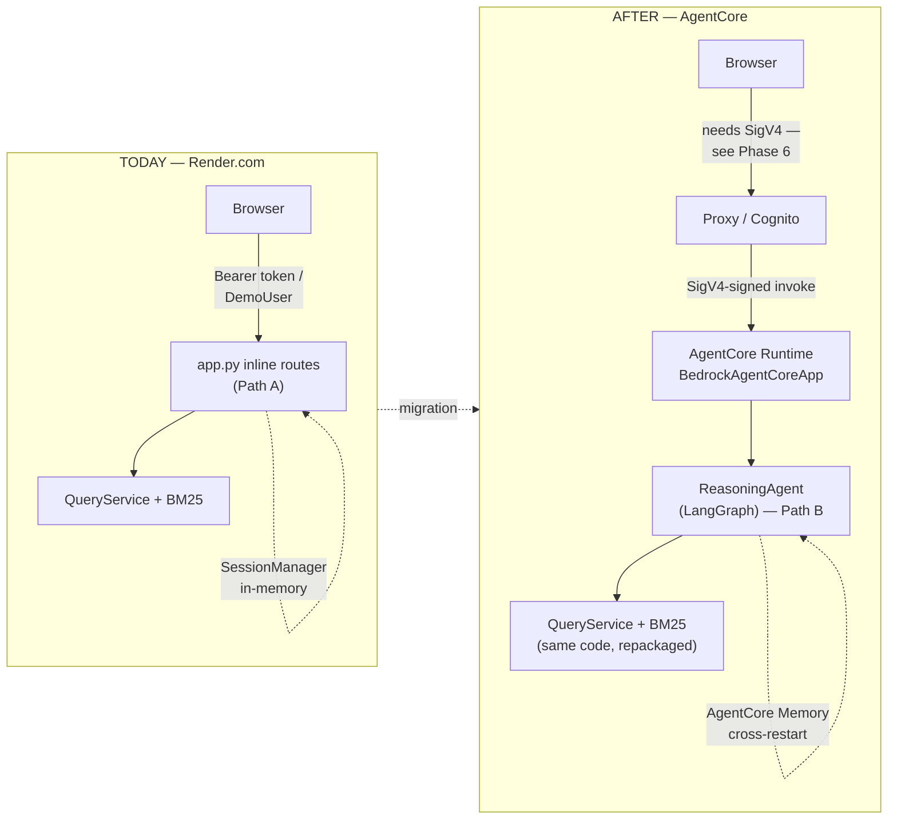
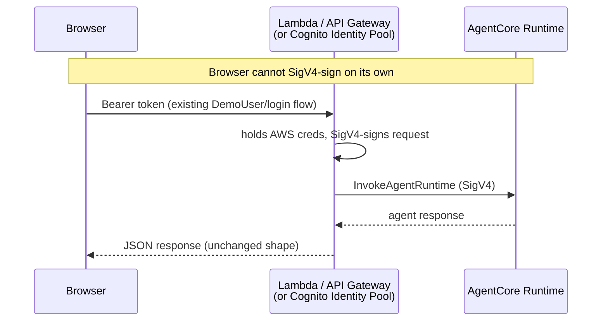

# Compass → AWS Bedrock AgentCore — Migration Plan

A step-by-step plan for moving Compass's reasoning agent off Render onto AWS Bedrock AgentCore Runtime — mapped against the actual codebase, not a generic tutorial.

> Prepared by Sai Kiran Arvala · 2026-10-04 · Current as of AWS's October 2026 tooling (`@aws/agentcore` CLI)
>
> Companion reference (same content, browsable): [Compass AgentCore Migration artifact](https://claude.ai/code/artifact/f88304d5-e4f4-4d2a-96fc-b35bf8af3d48)

---

## Strategy: this migration targets Path B, not Path A

AgentCore Runtime's invocation contract (`BedrockAgentCoreApp` + `@app.entrypoint`) wraps **an agent**, not a tree of REST routes. Compass's `ReasoningAgent` (LangGraph) is already implemented but not registered with `app.py` (see `CLAUDE.md`'s "Two-Path Request Handling"). Moving to AgentCore effectively means finishing that activation as a side effect, not new scope — the currently-active Path A (inline FastAPI routes) doesn't map onto AgentCore's model at all.

## Today vs. After — what actually changes



The core logic (`QueryService`, BM25, guardrails) carries over unchanged. What's new: the entrypoint contract, durable session memory, and — the one real gotcha — how the browser authenticates to a SigV4-only invoke API.

## What moves, what stays

Mapped to actual Compass modules:

| Compass piece | AgentCore mapping | Verdict |
|---|---|---|
| `ReasoningAgent` (LangGraph) | Wrapped by `BedrockAgentCoreApp` | **Moves** |
| `ToolRegistry` tools (`core_tools.py`) | Local in-process (Gateway optional) | **Stays** |
| `CorpusStore` + `.atlas/` BM25 cache | Bundled into the Runtime container image | **Repackaged** |
| `GuardrailPipeline` | No AgentCore equivalent — runs inside your entrypoint | **Stays** |
| `SessionManager` | `AgentCoreMemorySaver` checkpointer | **Replaced** |
| `AuditLogger` / `.audit_logs/` | AgentCore Observability (CloudWatch/OTel) | **Complemented** |
| DeepSeek via OpenRouter | Unrelated — Runtime is model-agnostic | **Stays** |
| React/Vite frontend | Not an AgentCore concern | **Stays** (see Phase 6) |
| `IndexTreeBuilder` (offline) | Unrelated to Runtime — batch job | **Stays** |

---

## Phase 0 — Decide what actually moves

Use the table above as the scoping document before writing any code — it's the difference between a weekend migration and a quarter-long one.

## Phase 1 — Stand up the AWS side

- **Enable Bedrock model access** in your target region — even if you keep calling OpenRouter/DeepSeek, Runtime lives in a Bedrock-adjacent account setup.
- **Install the current CLI:** `npm install -g @aws/agentcore`.
- **Create IAM roles:** an execution role for the Runtime (`bedrock-agentcore:*`, CloudWatch logs/traces, S3 read for the corpus bundle, Secrets Manager/SSM for `OPENROUTER_API_KEY`), plus a Gateway role only if Phase 3 needs it.

> **Tooling changed:** AWS replaced the CLI recently. The old `bedrock-agentcore-starter-toolkit` (pip, `agentcore configure`/`launch`) is now legacy — installing the new one warns you to uninstall it. Don't follow older tutorials that reference the Python CLI verbatim.

## Phase 2 — Wrap the LangGraph agent for Runtime

Smaller than it sounds. New entrypoint module, e.g. `src/compass/agentcore_app.py` — your existing graph, tools, and guardrails import unchanged:

```python
# src/compass/agentcore_app.py
from bedrock_agentcore import BedrockAgentCoreApp
from compass.agent.agent import build_reasoning_agent
from compass.agent.core_tools import ToolRegistry
from compass.retrieval.service import QueryService
from compass.guardrails.pipeline import GuardrailPipeline

app = BedrockAgentCoreApp()
service = QueryService()           # built once per container
registry = ToolRegistry(service=service, docs_root="docs")
guardrails = GuardrailPipeline()
graph = build_reasoning_agent(tools=registry)

@app.entrypoint
def invoke(payload, context):
    identity = context.session_id or "anonymous"
    gr = guardrails.check_request(payload["query"], identity)
    if gr.decision in ("REFUSE", "RATE_LIMIT"):
        return {"answer": gr.message, "guardrail": gr.to_dict()}

    state = graph.invoke(
        {"query": payload["query"], "variant": payload.get("variant", "CloudNative")},
        config={"configurable": {"thread_id": context.session_id}},
    )
    out = guardrails.check_response(state["answer"])
    return {"answer": out.answer, "citations": state["citations"], "guardrail": out.to_dict()}

if __name__ == "__main__":
    app.run()
```

## Phase 3 — Tools: don't over-migrate to Gateway

Gateway's job is turning APIs/Lambdas into **standardized, shareable** MCP tools — valuable if other teams or agents need `lexical_search` too. For Compass's five tools today, keep them in-process: they already take their dependencies at construction (`ToolRegistry(service, docs_root)`) and enforce variant isolation internally. Gateway adds an extra network hop with no benefit unless you're sharing a tool outside Compass, or want Cedar-policy tool authorization independent of your own code.

## Phase 4 — The corpus problem

AWS's own migration guide deploys via a small zip to S3 — fine for a 100-line agent, not fine for Compass's ~3,970-document corpus and `.atlas/*.json.gz` BM25 cache. Use **container image deployment** instead:

- Build a Docker image that includes `docs/` (or at minimum the prebuilt `.atlas/corpus_*.json.gz` caches) and runs `scripts/build_index.py` at build time — same pattern as today's `requirements-render.txt` build.
- Push to ECR; point Runtime at the image.

> **Gotcha:** If you ever fall back to the zip path, vendor dependencies for `manylinux2014_aarch64` / Python 3.12. Wheels built on an x86 laptop silently fail on Runtime's ARM64 microVMs with **cryptic timeout errors, not `ModuleNotFoundError`**.

## Phase 5 — Memory replaces SessionManager

```python
# replaces services/session.py's in-memory SessionManager
from langgraph_checkpoint_aws import AgentCoreMemorySaver

graph = build_reasoning_agent(
    tools=registry,
    checkpointer=AgentCoreMemorySaver(memory_id, region_name=region),
)
```

This gets cross-restart, cross-replica session persistence for free — something the current in-memory `SessionManager` doesn't have. Sessions idle out after 15 minutes by default (tunable 60s–8h via `idleRuntimeSessionTimeout`).

## Phase 6 — The frontend auth gotcha

The one real architectural change here — not a lift-and-shift. AgentCore Runtime's invoke API requires **SigV4 signing**. The current flow (`CompassAPI` → Bearer token → `app.py`) can't SigV4-sign from a browser.



Keep your existing Bearer-token/DemoUser auth in front of the proxy — only the hop from proxy to Runtime is new. Don't discover this during cutover; it changes `services/api.ts` and the gateway's auth model, not just the backend.

## Phase 7 — Observability & guardrails

- Enable **CloudWatch Transaction Search** once at the account level — Runtime auto-instruments traces/metrics with no code changes, unlike today's manual LangSmith `wrap_openai` wrapping.
- Keep `GuardrailPipeline` exactly as-is inside the entrypoint (Phase 2) — AgentCore has no equivalent to the injection/PII/off-topic layered checks.
- `.audit_logs/` JSONL is ephemeral per-session on Runtime — mirror important guardrail events to CloudWatch or S3 if they need to outlive a session.

## Phase 8 — Cutover

- Deploy: `agentcore create` → `agentcore dev` (local test) → `agentcore deploy`.
- Run **in parallel** with the Render Path-A deployment — point a feature flag or a small % of frontend traffic at the new proxy endpoint.
- Define acceptance criteria *before* comparing — e.g. "≥90% of Path-A's answers match on a 50-query regression set." Agents won't behave identically after the move.
- Cut `VITE_API_URL`/proxy routing over once criteria are met; decommission the Render backend. The Render static frontend stays (or migrates separately) — AgentCore doesn't host it.

---

## Sources

Grounded in current AWS documentation as of October 2026:

1. [Migrate agentic workloads to Amazon Bedrock AgentCore — AWS ML Blog](https://aws.amazon.com/blogs/machine-learning/migrate-agentic-workloads-to-amazon-bedrock-agentcore/)
2. [Introducing Amazon Bedrock AgentCore Gateway — AWS ML Blog](https://aws.amazon.com/blogs/machine-learning/introducing-amazon-bedrock-agentcore-gateway-transforming-enterprise-ai-agent-tool-development/)
3. [Amazon Bedrock AgentCore — AWS Prescriptive Guidance](https://docs.aws.amazon.com/prescriptive-guidance/latest/agentic-ai-frameworks/amazon-bedrock-agent-core.html)
4. [aws/agentcore-cli (GitHub)](https://github.com/aws/agentcore-cli)
5. [aws/bedrock-agentcore-starter-toolkit (GitHub, legacy)](https://github.com/aws/bedrock-agentcore-starter-toolkit)
